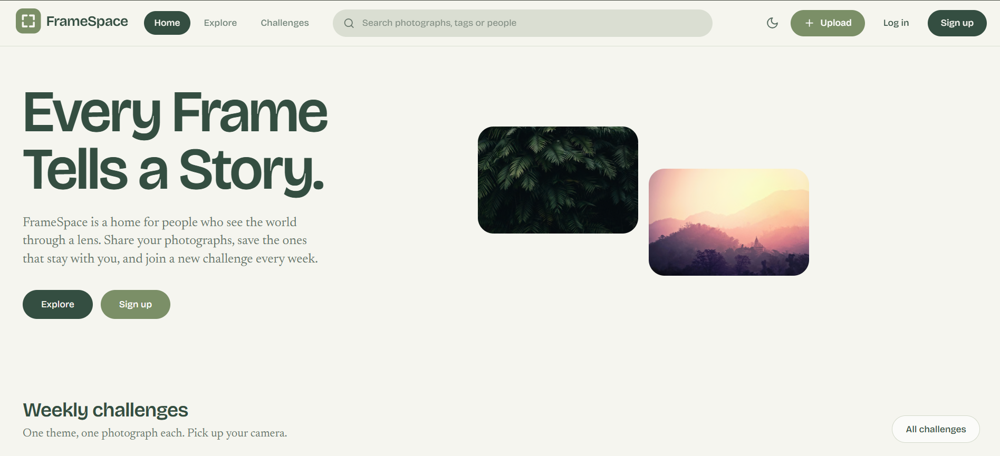
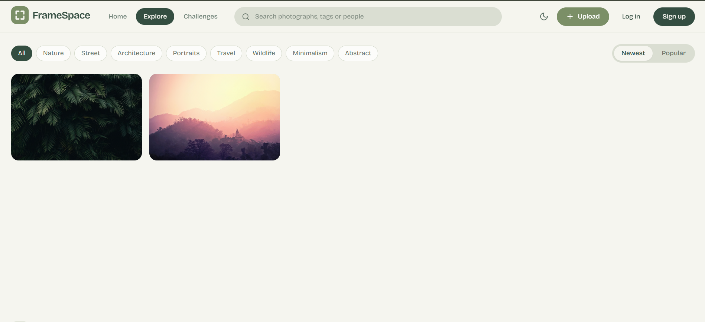
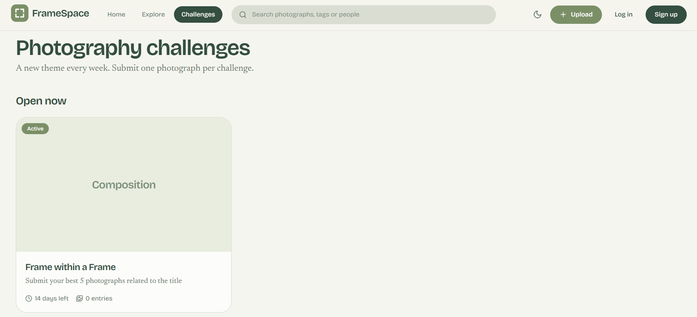
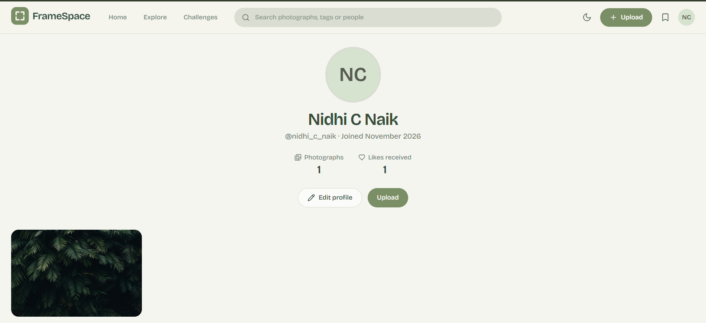
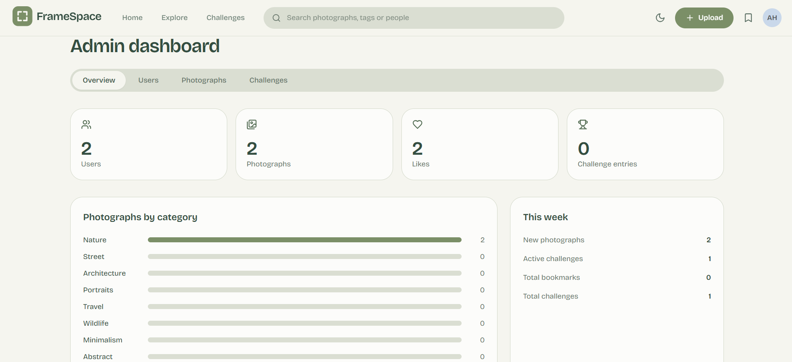

# FrameSpace

### Every frame tells a story.

FrameSpace is a full-stack photo-sharing platform where users can discover, upload, share and interact with photographs. It also features photography challenges that encourage users to explore creativity through themed assignments and community participation.

The project was developed to explore full-stack web development, including frontend architecture, REST API development, authentication, database management and image-handling workflows.

## ✨ Features

- **User Authentication** – User registration, login and protected routes.
- **Photo Sharing** – Upload and share photographs with the community.
- **Explore Feed** – Discover photographs shared by other users.
- **Photography Challenges** – Create, discover and participate in photography challenges.
- **Social Interactions** – Like and bookmark photographs.
- **User Profiles** – View user profiles and uploaded photographs.
- **Admin Dashboard** – Administrative functionality for managing platform content.
- **Responsive Interface** – A clean interface designed for different screen sizes.
- **Theme Support** – Light and dark theme options.

## 🛠️ Tech Stack

| Layer | Technologies |
|---|---|
| Frontend | React.js, Vite |
| Styling | Tailwind CSS, CSS |
| Routing | React Router |
| Backend | Node.js, Express.js |
| Database | MongoDB, Mongoose |
| Authentication | JSON Web Tokens (JWT) |
| Image Storage | Cloudinary (optional configuration) |
| API Communication | REST API, Axios |
| Version Control | Git, GitHub |

## 🏗️ Project Architecture

FrameSpace follows a client-server architecture.

```text
                 FrameSpace
                     |
          +----------+----------+
          |                     |
       Frontend               Backend
       (React)               (Node.js)
          |                     |
     React Router           Express.js
          |                     |
     Components             REST APIs
          |                     |
     Context API           Controllers
          |                     |
     API Services            Models
          |                     |
          +----------+----------+
                     |
                  MongoDB
                     |
                Cloudinary
              (Image Storage)
```

### Folder Structure

```text
FrameSpace/
│
├── frontend/
│   ├── public/
│   └── src/
│       ├── components/
│       ├── context/
│       ├── hooks/
│       ├── pages/
│       ├── services/
│       └── utils/
│
├── backend/
│   └── src/
│       ├── config/
│       ├── controllers/
│       ├── middleware/
│       ├── models/
│       ├── routes/
│       ├── seed/
│       └── utils/
│
├── .gitignore
└── README.md
```

## ⚙️ Getting Started

Follow these instructions to run FrameSpace locally.

### Prerequisites

- Node.js and npm
- MongoDB Atlas account or a local MongoDB instance
- Git
- Cloudinary account (optional, for image uploads)

### 1. Clone the Repository

```bash
git clone https://github.com/anjushree022/FrameSpace.git
cd FrameSpace
```

### 2. Configure the Backend

Navigate to the backend directory:

```bash
cd backend
npm install
```

Create a `.env` file using the provided example:

```bash
cp .env.example .env
```

On Windows PowerShell, you can alternatively use:

```powershell
Copy-Item .env.example .env
```

Configure the required environment variables using the names specified in `backend/.env.example`.

At minimum, configure your MongoDB connection string and JWT secret. Add Cloudinary credentials if you want image uploads enabled.

### 3. Start the Backend

```bash
npm run dev
```

The backend runs at:

`http://localhost:5001`

### 4. Configure the Frontend

Open a second terminal:

```bash
cd frontend
npm install
```

Create the frontend environment file if required by the project:

```bash
cp .env.example .env
```

Use the variable names specified in `frontend/.env.example`.

### 5. Start the Frontend

```bash
npm run dev
```

The frontend runs at:

`http://localhost:5173`

Open the local URL in your browser.

## 🔐 Environment Variables

Environment files contain sensitive configuration and must never be committed to GitHub.

The repository includes `.env.example` files to demonstrate the required configuration without exposing actual credentials.

Never publish:
- MongoDB connection credentials
- JWT secrets
- Cloudinary API secrets
- Other private API keys or tokens

## 📸 Screenshots

Screenshots of the following application pages can be added here:


## 📸 Screenshots

### 1. Landing Page


### 2. Explore Feed


### 3. Photography Challenges


### 4. User Profile


### 5. Admin Dashboard



## 🎯 Learning Outcomes

Building FrameSpace provided practical experience with:

- Developing reusable React components.
- Managing application state using React Context.
- Implementing client-side routing and protected routes.
- Building RESTful APIs using Node.js and Express.
- Connecting a frontend application with a backend.
- Designing and managing MongoDB schemas.
- Implementing JWT-based authentication.
- Handling image uploads and external storage integration.
- Organizing a full-stack application into maintainable modules.
- Using Git and GitHub for version control.

## 🚀 Future Improvements

- Add comments and richer social interactions.
- Introduce advanced photo search and filtering.
- Improve image optimization and loading performance.
- Add notifications for user interactions.
- Deploy the application for public access.

## 👩‍💻 Author

**Anjushree**

GitHub: [@anjushree022](https://github.com/anjushree022)

---

*FrameSpace – Every frame tells a story.*
